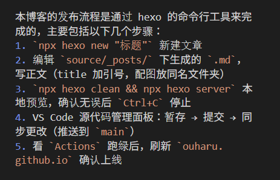

本博客的发布流程是通过 hexo 的命令行工具来完成的，主要包括以下几个步骤：
1. `npx hexo new "标题"` 新建文章
2. 编辑 `source/_posts/` 下生成的 `.md`，写正文（title 加引号，配图放同名文件夹）
3. `npx hexo clean && npx hexo server` 本地预览，确认无误后 `Ctrl+C` 停止
4. VS Code 源代码管理面板：暂存 → 提交 → 同步更改（推送到 `main`）
5. 看 `Actions` 跑绿后，刷新 `ouharu.github.io` 确认上线

---

(end)
